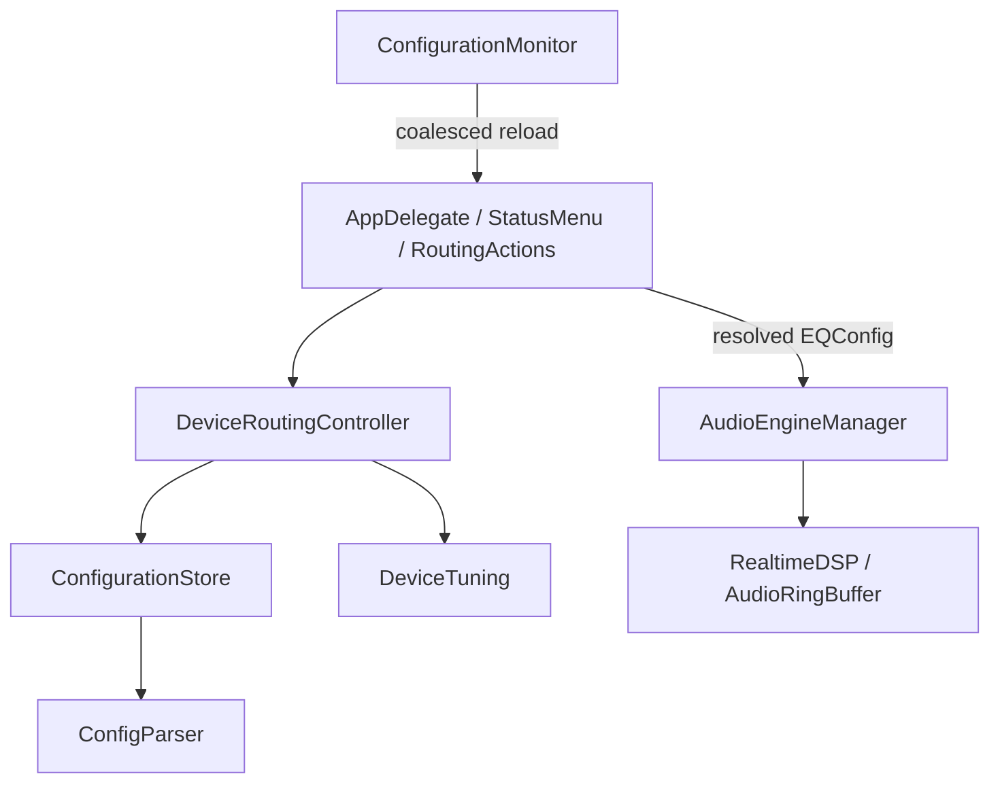

# MiraEQ architecture

The menu and audio engine share one resolved device configuration. The current
render path is the [dedicated speaker engine](speaker-engine.md); legacy effect
fields remain readable but are normalized out before rendering. The app has
one executable target and its existing Atomics dependency; configuration does
not need a service container, plugin system, database, or event bus.

## Ownership

| Component | Owns |
| --- | --- |
| `AppDelegate`, `StatusMenu`, `RoutingActions` | macOS lifecycle, menu actions, user pause, applying the resolved route to the engine |
| `DeviceRoutingController` | current device, routing rules, selected base preset, per-device overrides, configuration read errors |
| `ConfigurationStore` | config paths, file reads/writes, first-install seeding, legacy flat-preset copies, preset catalog titles |
| `DeviceTuning` | sparse overrides, effective configuration composition, hidden-preset serialization |
| `ConfigParser` | existing text formats, aliases, numeric bounds, extracting explicit override fields |
| `ConfigurationMonitor`, `FileWatcher` | observing changes, debouncing reloads, reattaching after atomic file replacement |
| `AudioEngineManager` | serialized capture/playback lifecycle, graph updates, auto-standby, diagnostics |
| `RealtimeDSP`, `AudioRingBuffer` | existing realtime processing and capture/playback buffer |

## Configuration rules

The on-disk layout remains `~/.config/MiraEQ/config.txt`, `presets/device/*.txt`,
and `presets/addons/*.txt`, including existing hidden processing files. Existing
files are seeded only when absent. File watching never creates or deletes files.

Routing still uses the first case-insensitive exact match against the output
name or UID. New menu selections use the UID when available; name rules remain
readable. An explicit `None` entry keeps the per-device tuning reference through
a bypass/re-enable cycle. Selecting a different EQ preset does not rewrite the
hidden processing file.

Each `DeviceTuning` property is optional:

- `nil`: inherit that field from the base EQ preset.
- `0` or `false`: explicitly disable the selected processing feature.
- A value: override only that field.

The hidden preset uses the existing `Effect:` syntax and writes only the fields
that are set. Reading tracks the presence of each valid parameter independently
of its value. This allows a Bass Harmonics amount of zero to remain off and
prevents a Bass Focus edit from implicitly enabling Spatial or changing latency.
Legacy distance/strength fields are readable for compatibility but the speaker engine ignores them.
Float values round-trip without two-decimal rounding or latency-mode snapping.

Composition runs once against the base preset through `DeviceTuning.applying`.
The runtime and `--print-effective-config` verification use that same method.
When neither the base preset nor an override specifies latency, the target is
1 ms. The speaker profile forces unity global gain and disables legacy spatial effects. Low-end guard parameters and other base effects continue to come
from the EQ preset. The bundled Rich/hidden pair now matches the active 55 Hz high-pass speaker profile
with unity global gain and Bass Mono disabled.

Menu checkmarks display effective values. “Reset Processing to Preset” clears
all menu overrides, including legacy spatial overrides. The narrower Bass Focus reset clears only its own override. Saving a single
setting does not pin the inherited settings to today's base-preset values.

## Changes and failures

A route is published to controller state after its inputs can be read and any
requested writes succeed. An I/O failure during reload keeps the last complete
configuration. A failed switch to a different device bypasses processing for
that device rather than carrying the previous device's EQ across the switch.
Parse warnings retain the existing permissive parser behavior and are logged;
this is not a strict schema validator.

The configuration monitor watches routing, the two preset directories, and the
currently referenced files that exist. Directory watches discover new files;
file watches catch in-place writes. Active files reattach after atomic saves.
Change notifications are coalesced over 300 ms. Writes from the app follow the
same reload path, so no watcher needs to be disabled around writes. Stopping a
watcher invalidates pending reattachment; stopping the monitor cancels reloads.
The diagnostics snapshot is outside the watched directories.

Two files are needed when first attaching a hidden tuning preset to a route.
Settings are written before the routing reference, and in-memory state is
committed last. These individual atomic file writes are not a filesystem
transaction: a failed second write can leave an unreferenced hidden file.

The engine skips identical live graph updates, preserving an in-progress fade.
Its app-facing `applyConfiguration` entry point still serializes start requests
so the last requested route wins even during a rapid device switch. A config edit during standby updates the
configuration to use on resume without waking capture. Playback detection and
“Wake from Standby” use the explicit start path. Start and live-update helpers
are private, keeping lifecycle changes serialized. Manual Restart is available
whenever a usable route exists, including after a failed start.

Silence standby requires both 120 seconds without audible samples and no other
running output stream on the selected physical device. MiraEQ's own output is
excluded. [Core Audio's output-running property](https://developer.apple.com/documentation/coreaudio/audiohardwareprocess/isrunningoutput)
reports stream activity, not sample audibility. A browser can keep the same
stream running through silence and resume sound without changing its process
object. Such a stream must stay processed; after capture is torn down there is
no observable playback edge on which to resume. The previous permanent baseline
process exclusion could therefore leave EQ bypassed indefinitely.

Standby resumes when any other process has a running stream on that device;
there is no baseline exemption. Mute and zero volume still stop capture even
with live streams. Missing hardware volume controls are treated as unknown,
rather than zero, so those devices can resume. A failed process enumeration
does not count as proof of stopped playback. Diagnostics are written once on
standby, resume, and explicit stop transitions, in addition to active refreshes.

## Verification

`swift build` checks the executable; `swift test` covers parser compatibility,
sparse overrides, explicit off, precise serialization, the bundled effective
configuration, routing identity, bypass/re-enable, failed I/O, and actual
filesystem notifications for in-place/atomic saves and watcher shutdown. Standby
policy tests cover persistent silent streams, returning process objects, mute,
zero volume, unknown volume controls, and unavailable playback activity.
Tests use temporary configuration directories and do not write the user's
MiraEQ configuration or start a CoreAudio process tap.

DSP equations, signal ordering, and HAL resource management remain in the
existing audio implementation. The configuration tests do not establish
listening quality, dropout behavior, hardware hot-plug behavior, or permission
behavior. Those require a macOS app run with real playback and output devices.
